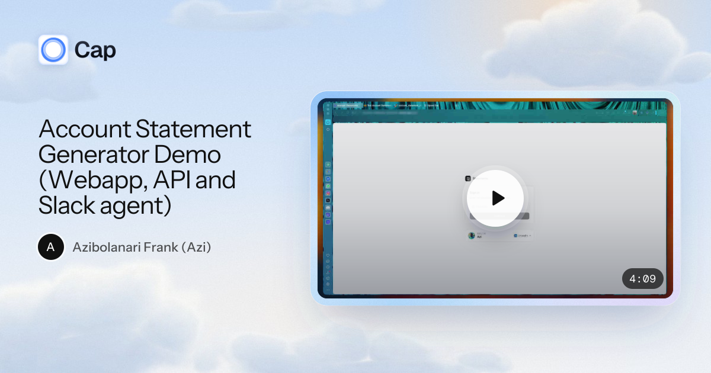
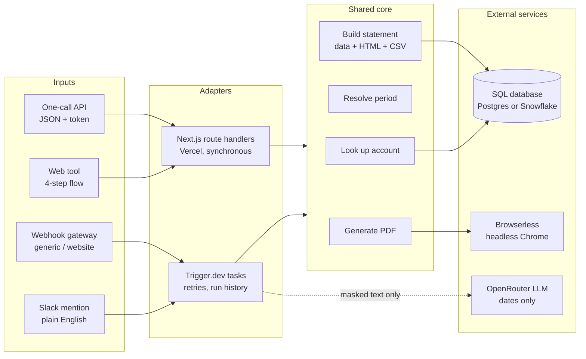
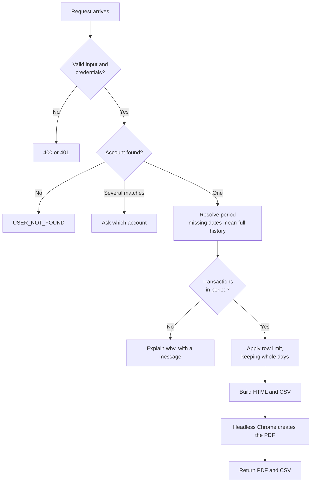
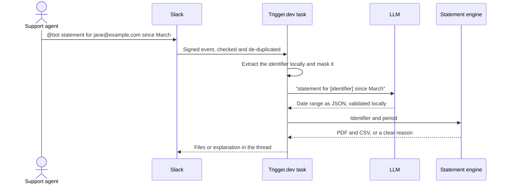

<p align="center">
  
</p>

# Account Statement Engine

Turn a Slack message, a form click or an API call into a branded PDF and CSV account statement.

This project replaces a fragile 22-node n8n workflow with a tested, modular TypeScript system. Three channels share one engine, so a new channel means writing one more adapter, not changing the business logic.

**[Live app](https://account-statement-generator.vercel.app)** (sign-in requires a passcode, so [ask me for one](https://www.linkedin.com/in/azifrank)) · [Engineering notes](docs/engineering-notes.md)

> SendFast is a fictional company used for this showcase. This repository contains no customer data or production credentials.

[](https://cap.so/s/sqd4vhnx6rmcweq)

## Before and after

| | n8n workflow | This engine |
|---|---|---|
| **Ways in** | Slack only | Slack, web tool and API, plus a webhook gateway |
| **When something breaks** | No error branches, so the requester hears nothing | Every Slack request gets a reply, and errors carry a reference ID |
| **SQL** | Input pasted into query strings | Bound parameters |
| **AI output** | Cleaned with regular expressions and used as-is | Validated against a schema, and unclear dates prompt a question |
| **Page layout** | Fixed row counts per page | Pages fitted to measured row height |
| **Tests** | None | 128 automated tests |

## Architecture

Business logic lives in a core that knows nothing about Slack, HTTP or Trigger.dev. Each entry point is a thin adapter.



## How a statement is generated



## How a Slack request stays private

Only the words around the dates reach the AI model. Customer identifiers are removed first, and database records and PDF content are never sent to it.



## The API

`POST /api/statement` takes a bearer token and returns the statement in the same response.

```bash
curl -s https://<your-deployment>/api/statement \
  -H "Authorization: Bearer $STATEMENT_API_TOKEN" \
  -H "Content-Type: application/json" \
  -d '{"userId":"customer@example.com","from":"2026-01-01","to":"2026-03-31"}' > statement.json

jq -r .contentBase64 statement.json | base64 --decode > statement.pdf
jq -r .csv.contentBase64 statement.json | base64 --decode > statement.csv
```

Only `userId` is required, and it accepts a user ID or an email. See the [API reference](docs/vercel.md#one-call-statement-api-appapistatementroutets) for responses and errors, or try it from the [notebook](examples/Test_Account_Statement_Generator.ipynb).

## Engineering highlights

- **Clear failure behaviour.** Business rejections explain themselves. Unexpected failures return only a reference ID that matches the server log.
- **Tested at volume.** The largest stress test produced 151 pages from 1,500 transactions with no overflowing pages.
- **Secure by default.** It uses bound SQL, strict input validation, constant-time token checks, signed Slack events and CSV injection protection, and it refuses to start without valid credentials.
- **Replaceable infrastructure.** The database, PDF renderer, storage and clock sit behind interfaces. Postgres and Snowflake both work with the same engine.
- **Editable without touching the engine.** SQL, HTML, payloads and PDF options live in [`core-files/`](core-files/README.md).

## Stack

TypeScript · Next.js · Trigger.dev · Vercel · Postgres / Snowflake · Browserless · OpenRouter · Slack API · shadcn/ui · Zod

## Run it yourself

Requires Node.js 22.13+.

```bash
npm ci
cp .env.example .env
npm run typecheck
npm test        # no external services needed
npm run dev     # needs the database, Browserless and web tool values in .env
```

[Engineering notes](docs/engineering-notes.md) cover the full setup, and [Slack](docs/slack.md) and [Vercel](docs/vercel.md) each have their own guide.

## License

[MIT](LICENSE)
