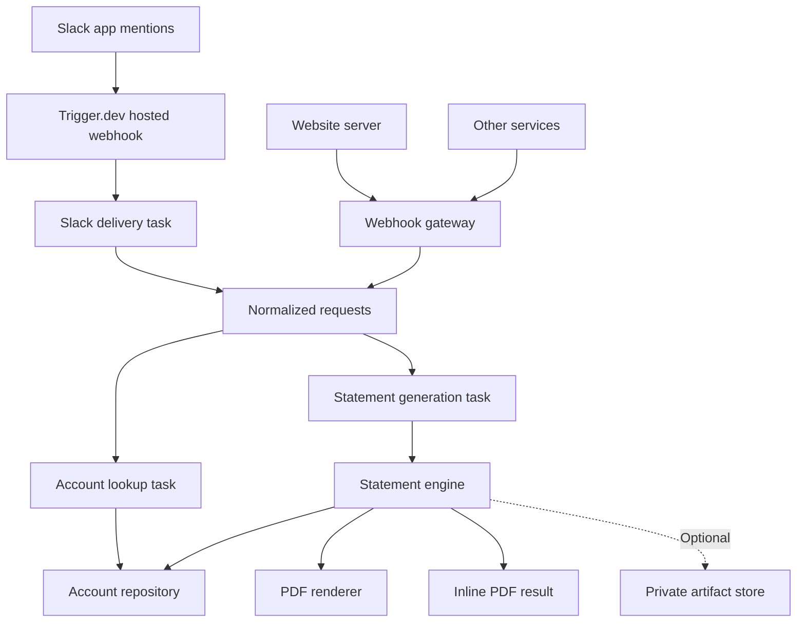

# Engineering notes

Detailed setup, API and behaviour reference for the statement engine. Start with the [README](../README.md) for the overview.

The engine accepts a common request format. Source adapters translate their inputs into that format; they do not implement account lookup, transaction retrieval, coverage rules, or PDF construction.

## Architecture



The webhook gateway is a small Node HTTP service, deployed separately from Trigger.dev workers. There is no requirement to use Sites or any particular frontend framework. A later source plugin may use Trigger.dev's native webhook features instead; the domain engine does not change.

## Flows

Two inputs share one core: account lookup → period resolution → statement data, HTML and CSV → PDF.

- **Slack (natural language, via Trigger.dev).** Mention the bot with an email or user ID and optional dates. The thread gets a PDF and a CSV, or a reason why not. If anything crashes, the thread gets a failure notice with a run reference. See [Slack setup](slack.md).
- **Web app (structured, synchronous).** Lookup → confirm → choose period → HTML preview → PDF/CSV download, through `src/app-api/handlers.ts` mounted as Next.js routes on Vercel. See [Web app on Vercel](vercel.md).

- **Statement API (structured, one call).** `POST /api/statement` on Vercel with a bearer token and `{ userId, from?, to? }` returns the PDF and CSV as base64 JSON. Tokens are a comma-separated list in `STATEMENT_API_TOKEN`, each optionally expiring (`token:YYYY-MM-DD`); `npm run token` generates one. See [Web app on Vercel](vercel.md#one-call-statement-api-appapistatementroutets).

**Default period:** whatever isn't given defaults to the full history, which is the first transaction date through today (UTC). The end date is never later than today.

### Try the API from a notebook

[`examples/Test_Account_Statement_Generator.ipynb`](../examples/Test_Account_Statement_Generator.ipynb) is a ready-made Jupyter or Colab notebook for teammates. It asks for the API URL and a token (hidden prompts, never saved), calls the API, decodes the base64 response and saves the PDF and CSV with download links. It needs only `requests` (`%pip install requests`). Ask the project owner for a token, and clear the outputs before committing changes to the notebook, because they contain the full statement.

## Implemented

- `statement.lookup-account`: searches by normalized user ID/email; returns not found, no history, a single account, or multiple candidates for explicit selection.
- `statement.generate-from-text`: extracts the account identifier locally, masks identifiers before OpenRouter date extraction, then uses the shared lookup and generation engine.
- `statement.generate`: accepts the confirmed user ID and explicit inclusive dates; fetches transactions; prepares the statement; renders a PDF and returns it directly, or optionally saves it to configured storage.
- Generic and website server-to-server webhook adapters, asynchronous dispatch, run polling, and inline PDF content, and short-lived preview/download URLs when storage is enabled.
- SQL bound parameters, full end-day coverage, UTC date handling, stable transaction ordering, and full matching counts before the row limit.
- Existing 1,500-row target and 1,600-row ceiling, preserving whole UTC days and retaining the oldest days first. Output remains newest first. Truncation is explicit.
- Dependency-injected account repository, PDF renderer, optional artifact store, clock, and HTML renderer.
- Branded HTML statement template with an embedded logo; customer strings are escaped and displayed times are explicitly UTC.
- Operational task retries and explicit non-retryable business outcomes. Deterministic artifact keys avoid duplicate files on retries.
- Slack app mentions: Trigger.dev hosted signed webhook, workspace/access-list filtering, event deduplication, threaded acknowledgments and PDF uploads via `statement.slack`. See [Slack setup](slack.md).

## Deliberately deferred

- Per-user authentication: the web tool uses shared passcodes and the API uses bearer tokens.
- Slack conversation state, interactive account selection/confirmation, and automatic delivery retries.
- Statement formats beyond PDF and CSV.

The source labels are routing metadata, not proof of authorization. The gateway currently trusts one internal service credential with access to all statement jobs. Before adding external users, implement principal-based account authorization, run ownership, audit records, and rate limits. Never expose the service token or Trigger.dev secret in a browser.

## Editing statement logic and appearance

The editable source files are in [`core-files/`](../core-files/README.md): SQL queries, statement payload, HTML builder, HTML request payload, and PDF options. Existing adapters reference those files directly. Change the relevant core file once, then redeploy the commit; no duplicate source needs updating.

## Layout

| Path | Responsibility |
|---|---|
| `src/domain/contracts.ts` | Canonical inputs, data types, business errors |
| `src/domain/ports.ts` | Replaceable infrastructure interfaces |
| `src/domain/coverage.ts` | Complete-day PDF coverage policy |
| `src/services/engine.ts` | Shared account lookup and statement generation |
| `src/services/runtime.ts` | Production dependency wiring |
| `src/services/database.ts` | Selects Postgres (default) or Snowflake |
| `src/adapters/snowflake.ts` | Snowflake connection, authentication, and shared repository adapter |
| `src/adapters/postgres.ts` | Executes the SQL in `core-files/sql/` with bound parameters |
| `src/adapters/statement-html.ts` | References the HTML builder in `core-files/statement-html.ts` |
| `src/adapters/browserless.ts` | HTML-to-PDF transport |
| `src/adapters/storage.ts` | S3-compatible private artifact storage |
| `src/adapters/slack-input.ts` | Slack signature verification and identifier extraction |
| `src/trigger/statements.ts` | Trigger.dev task definitions |
| `src/http/dispatch.ts` | Webhook normalization and deduplicated dispatch |
| `src/http/server.ts` | Authenticated HTTP gateway and status endpoint |
| `tests/engine.test.ts` | Synthetic business, SQL, input, and HTTP checks |

## Setup

Requires Node.js 22.13+ and npm. Dependencies are pinned by `package-lock.json`.

```bash
npm ci
cp .env.example .env
npm run typecheck
npm test
```

Create a Trigger.dev project. Set `TRIGGER_PROJECT_REF` and `TRIGGER_SECRET_KEY` in `.env`. The gateway needs permission to trigger tasks AND read their runs; a trigger-only API key cannot serve the status endpoint. Keep credentials out of source control.

Set the database and Browserless configuration in `.env`. Storage is optional: leave `STATEMENTS_BUCKET` unset or empty to generate PDFs without configuring AWS/S3. Set a bucket and the relevant provider credentials only when you want PDFs saved.

Generate a long random `WEBHOOK_SERVICE_TOKEN`, e.g. with `openssl rand -hex 32`, and set it in `.env`.

Authenticate the CLI, then start the worker and gateway in separate terminals:

```bash
npx trigger.dev@4.8.1 login
# Export the project ref so trigger.config.ts can resolve it.
export TRIGGER_PROJECT_REF=proj_your_project
npm run trigger:dev
```

```bash
npm run webhooks
```

Trigger.dev development loads local environment values. For hosted workers, configure the database and PDF secrets, plus storage secrets only if saving is enabled in the corresponding Trigger.dev environment. Set the gateway's Trigger.dev API key and service token on its host. Deploy workers with `npm run trigger:deploy`; deploy the Node gateway to your chosen server/container host with TLS. The CLI and SDK are both version 4.8.1.

## Database selection

Set `DATABASE_PROVIDER` in the worker environment:

```env
DATABASE_PROVIDER=postgres
```

Postgres is the default when this variable is missing or blank. Existing `DATABASE_URL` configuration continues to work. To select Snowflake instead:

```env
DATABASE_PROVIDER=snowflake
SNOWFLAKE_ACCOUNT=your-org-your-account
SNOWFLAKE_USERNAME=statement_service
SNOWFLAKE_WAREHOUSE=COMPUTE_WH
SNOWFLAKE_DATABASE=APP_DB
SNOWFLAKE_SCHEMA=PUBLIC
SNOWFLAKE_ROLE=STATEMENT_READER
SNOWFLAKE_AUTHENTICATOR=SNOWFLAKE_JWT
SNOWFLAKE_PRIVATE_KEY=<PEM private key from your secret environment>
```

The account value is a Snowflake account identifier, not a Postgres URL. `SNOWFLAKE_ROLE` is optional; if omitted, Snowflake uses the user's default role. Key-pair authentication is the default for this adapter. Register the corresponding public key on the Snowflake user. Multiline private-key secrets and literal `\n` escapes are accepted. For encrypted keys, set `SNOWFLAKE_PRIVATE_KEY_PASSPHRASE`.

Other supported authentication choices:

| `SNOWFLAKE_AUTHENTICATOR` | Required credential |
|---|---|
| `SNOWFLAKE_JWT` (default) | `SNOWFLAKE_PRIVATE_KEY`; optional passphrase |
| `SNOWFLAKE` | `SNOWFLAKE_PASSWORD`; only if account policy permits password-only authentication |
| `OAUTH` | `SNOWFLAKE_TOKEN` containing a valid OAuth access token |
| `PROGRAMMATIC_ACCESS_TOKEN` | `SNOWFLAKE_TOKEN` containing a valid programmatic access token |

Supply and rotate tokens through your environment/secret manager; this adapter does not obtain or refresh OAuth tokens. Interactive SSO/browser/MFA sign-in is not implemented for background tasks.

Only the selected provider's credentials are required: Snowflake does not need `DATABASE_URL`, and Postgres does not need any Snowflake secrets. Unsupported provider names fail explicitly. The setting applies to both lookup and generation; changing it is a deployment/environment choice, not an input that website visitors can override.

The existing Postgres SQL stays in `core-files/sql/`. Snowflake SQL lives in [`core-files/sql/snowflake/`](../core-files/sql/snowflake/README.md). Both adapters return the same user and transaction fields to the shared engine. PDF rendering, complete-day coverage, optional storage, and input integrations use the same logic for both providers.

Snowflake SQL templates target `users` and `transactions`. Edit them for your Snowflake schema before live use, preserving the quoted output aliases. The adapter sets the session timezone to UTC, formats dates as strings, returns monetary columns as strings, and converts transaction counts to numbers. Timestamp-without-timezone values are assumed to represent UTC.

The driver connects lazily and closes its connection after the task. `snowflake-sdk` is excluded from the Trigger.dev bundle and installed as a runtime dependency so its internal assets can load normally. SQL files are included by the existing asset packaging rule. These paths and driver behavior require verification in a real Trigger.dev/Snowflake run; the included tests use simulated database responses.

## API

All endpoints except `GET /health` require `Authorization: Bearer <WEBHOOK_SERVICE_TOKEN>`. These are internal server-to-server endpoints; the eventual website backend must authenticate its users before forwarding requests.

### Lookup

`POST /webhooks/generic` or `POST /webhooks/website` with `Content-Type: application/json`:

```json
{
  "operation": "lookup",
  "request": {
    "requestId": "a85c83cc-c825-4d77-a713-ba9058aa7779",
    "identifier": "customer@example.com"
  }
}
```

The adapter sets `source`; callers do not need to provide it. The response is HTTP 202:

```json
{"runId":"run_...","statusUrl":"/runs/run_..."}
```

`GET /runs/<runId>` returns execution status and the completed task output. The lookup output contains the matched users and their first and last transaction dates. Confirm the user before submitting a generation request; use those dates as the initial selected period. Multiple matches require explicit selection. This UI state belongs to the future website or Slack plugin.

### Generate

```json
{
  "operation": "generate",
  "request": {
    "requestId": "dcab573a-2536-4c3e-a7ee-53ab6468c3f1",
    "userId": "confirmed-user-id",
    "from": "2026-01-01",
    "to": "2026-01-31"
  }
}
```

Poll the returned status URL. Successful generation always includes coverage metadata and a PDF artifact.

**Default: generate without S3 storage.** Leave `STATEMENTS_BUCKET` unset, empty, or whitespace-only. The worker does not create a storage client or use any AWS/S3 configuration. The output includes:

```json
{
  "status": "COMPLETED",
  "fullName": "Sample Customer",
  "artifact": {
    "storage": "inline",
    "contentType": "application/pdf",
    "fileName": "Sample Customer Account Statement from 2026-01-01 to 2026-01-31.pdf",
    "encoding": "base64",
    "contentBase64": "<generated PDF encoded as base64>"
  },
  "csv": {
    "storage": "inline",
    "contentType": "text/csv",
    "fileName": "Sample Customer Account Statement from 2026-01-01 to 2026-01-31.csv",
    "encoding": "base64",
    "contentBase64": "<CSV encoded as base64>"
  }
}
```

Decode `output.artifact.contentBase64` to PDF bytes (and `output.csv.contentBase64` to the CSV) for preview, download, or Slack delivery. There is no S3 key or `downloadUrl` in this mode. Supplying AWS credentials alone does not enable saving.

**Optional: save PDFs.** Set `STATEMENTS_BUCKET` and configure access for the selected provider. Both `artifact` and `csv` have `storage: "s3"` and `key`, without inline content. Polling also returns `downloadUrl` (PDF) and `csvDownloadUrl`, each valid for five minutes. Poll again for a fresh URL after expiry. Never make the storage bucket public. If configured storage fails, the task reports/retries that failure rather than silently skipping the requested save.

Inline results must fit within Trigger.dev's task-output size limit. The engine guards serialized output at 9.5 MB, including base64 expansion and metadata; larger results return `PDF_TOO_LARGE_FOR_INLINE_OUTPUT`. Use a shorter period or enable storage for those PDFs.

Disabling S3 saving does not disable Trigger.dev's normal task-output retention. The inline PDF is part of the run output, and Trigger.dev can automatically offload large outputs to its own object storage. The SDK resolves those outputs when polling. This mode removes the requirement for your own storage bucket; it does not promise zero persistence within Trigger.dev.

Use a new UUID for each new operation. Retry the same request with the same UUID and content to reuse its job within a 24-hour window. A changed request receives a different job and artifact fingerprint. Trigger.dev transport retries may rerender a PDF; when saving is enabled, they replace the same object key.

A business rejection returns a completed task output with `status: "REJECTED"` and one of:

- `USER_NOT_FOUND`
- `NO_TRANSACTION_HISTORY`
- `NO_TRANSACTIONS_IN_PERIOD`
- `PERIOD_TOO_DENSE`
- `PDF_TOO_LARGE_FOR_INLINE_OUTPUT`

Natural-language requests can also return `INVALID_IDENTIFIER`, `AMBIGUOUS_IDENTIFIER`, `ACCOUNT_SELECTION_REQUIRED`, `INVALID_DATE_RANGE`, `DATE_EXTRACTION_FAILED` and `DATE_CLARIFICATION_REQUIRED`. Every rejection carries a user-facing `message` (see `src/domain/messages.ts`).

Inspect output status in addition to Trigger.dev run status. Operational failures remain failed task attempts and are retried by Trigger.dev.

## Natural-language requests and OpenRouter

Structured requests (`lookup` and `generate`) never call OpenRouter and do not require an OpenRouter key. Natural-language requests use `statement.generate-from-text`:

```env
OPENROUTER_API_KEY=<set this as a secret>
OPENROUTER_MODEL=google/gemini-2.5-flash-lite
```

The default model is configurable. The chosen model/provider must support the JSON-schema response format. The editable date extraction instructions are in `core-files/date-extraction-prompt.ts`.

The processing boundary follows the supplied n8n JavaScript:

1. Extract the user ID or email locally, preferring IDs over emails.
2. Remove Slack mentions and replace **all recognized emails and 19–26-character alphanumeric IDs**, including repeated occurrences, with `<identifier>`.
3. Send only this redacted text and a UTC reference date to OpenRouter. The network adapter repeats identifier masking as a final safeguard. Account details, database rows, transaction records, and PDF content are never passed to the model.
4. Validate the model's date-only JSON locally and expand month-only boundaries. A request with no date words at all means "no dates". If the request has date words the model could not read, or the dates are invalid or reversed, it returns an explicit rejection asking for clarification instead of silently expanding the requested period.
5. Look up the local identifier and resolve the period (`src/domain/period.ts`). Missing sides default to the full history: the first transaction date through today (UTC), with the end capped at today. Generate the statement through the same engine. Unknown accounts, no history and multiple matches return `REJECTED` with a message; multiple matches must be resent with the user ID, and candidates are not returned on this path.

Identifier masking is not a general-purpose PII anonymizer: names, phone numbers, addresses, or other sensitive free text outside the specified patterns are not guaranteed to be removed. Sources should pass a statement request containing the account identifier and dates, not unrelated customer data. The original request can be retained by Trigger.dev as task input; the masking boundary described here is specifically the OpenRouter/model request. No raw request or provider response body is deliberately logged by this adapter.

`POST /webhooks/generic` (authenticated as before):

```json
{
  "operation": "natural-language",
  "request": {
    "requestId": "ea14cd43-214a-4cad-974d-ab930e2140eb",
    "text": "Account statement for customer@example.com for January 2026"
  }
}
```

The gateway returns a run ID to poll exactly as for structured generation. Successful results use the existing inline/storage PDF output. Source adapters can also invoke `statement.generate-from-text` directly with `source: "slack"`; the Slack Events API receiver and `statement.slack` task handle event routing and file delivery. See [Slack setup](slack.md).

Authentication/rate-limit/provider failures are operational errors; malformed model JSON and date clarification problems are explicit business rejections. Local tests inspect a simulated outgoing OpenRouter request to verify identifier redaction. A real model request still needs the configured API key and live verification.

## Coverage policy

The old SQL silently returned the newest 1,000 records before the 1,500/1,600 rule could run. This project removes that conflict. The SQL counts all matching rows and fetches up to 1,601 oldest records, sufficient to determine the existing complete-day cutoff. It then outputs the retained records newest first.

When truncated, the effective end date is the final included day. The requested dates remain in metadata. A mismatch between the first transaction date and the requested start date does not by itself mean truncation.

If the earliest transaction day alone exceeds 1,600 rows, generation rejects explicitly; a smaller date range cannot solve a single oversized day. Decide on pagination, a higher limit, or a separate high-volume export before supporting those cases.

## Checks before running this in production

1. Verify that `user_id` is unique in the selected database, and that its core SQL table/column names match the live schema.
2. Verify timestamp types. The adapter assumes `transaction_date` is `timestamptz`, or a `timestamp` storing UTC values. User defaults, date boundaries, and complete-day grouping all use UTC.
3. Replace the SendFast branding and confirm the business rules suit your environment.
4. Run a real Browserless request and verify the PDF against the current workflow. The renderer in `core-files/statement-html.ts` paginates by measured row height; long recipient fields and long addresses still deserve visual QA. Its imported layout is isolated with `@ts-nocheck`; the engine and adapter contracts remain strictly checked.
5. If saving is enabled, configure bucket privacy, retention/lifecycle deletion, encryption, and narrowly scoped worker permissions.
6. Apply production access policies, error monitoring, dependency review, and safe task-payload retention. Account identifiers and lookup outputs are visible to authorized Trigger.dev operators; no customer data is sent to an LLM by this implementation.
7. Register the gateway on a TLS host and verify authenticated request submission, run polling, file access, retries, and expected maximum volumes end to end.

## References

- [OpenRouter structured outputs](https://openrouter.ai/docs/guides/features/structured-outputs)
- [Trigger.dev manual setup](https://trigger.dev/docs/manual-setup)
- [Triggering tasks](https://trigger.dev/docs/triggering)
- [Idempotency](https://trigger.dev/docs/idempotency)
- [Retrieving runs](https://trigger.dev/docs/runs)
- [Snowflake connection authentication](https://docs.snowflake.com/en/developer-guide/node-js/nodejs-driver-authenticate)
- [Snowflake statement bindings](https://docs.snowflake.com/en/developer-guide/node-js/nodejs-driver-execute)
- [Slack request signature verification](https://docs.slack.dev/authentication/verifying-requests-from-slack/)

No production credentials or customer data are included in this repository.
